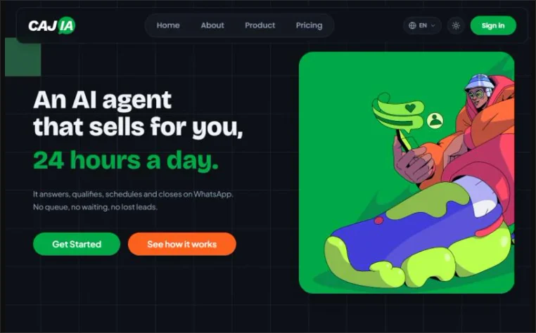
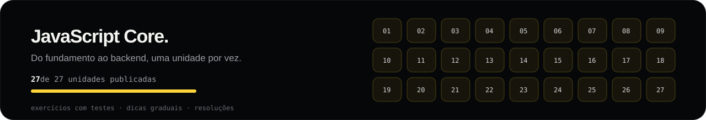

  
  
  
  

## Sobre

Engenheiro de software full stack e de IA em Salvador, BA. Construo e opero sistemas em produção com **TypeScript, NestJS, React, Java, Spring Boot e Python**, e coloco LLMs dentro de produtos reais com o mesmo cuidado de qualquer outra dependência: contrato, teste, métrica e plano de falha.

- 🤖 Agentes com function calling e MCP, RAG com PostgreSQL e pgvector, saída estruturada validada por schema
- 🛡️ Guardrails contra prompt injection, mascaramento de PII, cotas e menor privilégio por ferramenta
- 📊 Evals com dataset próprio no CI e observabilidade de tokens, custo, latência e qualidade
- 🧪 Testes unitários, de integração e E2E em todo projeto; pipeline que bloqueia deploy quando um teste quebra

## Engenharia de IA

## Projetos selecionados

<table>
  <tr>
    <td width="50%" valign="top">
      
      <h3><a href="https://andredeomondes.dev/projects/caji-agent">CajiAgent</a></h3>
      
Agente de IA de atendimento e vendas. Ferramentas com validação de argumentos, aprovação humana para ações financeiras e integrações com WhatsApp, Instagram e estoque.

      
<code>FastAPI</code> <code>Gemini</code> <code>Whisper</code> <code>React</code>

    </td>
    <td width="50%" valign="top">
      
      <h3><a href="https://andredeomondes.dev/projects/amr-mobile">AMR Mobile</a></h3>
      
Plataforma B2B de estoque e pedidos de iPhones no atacado, com pipeline de preços com LLM, saída estruturada e evals.

      
<code>Angular</code> <code>NestJS</code> <code>Python</code> <code>LangChain</code>

    </td>
  </tr>
  <tr>
    <td width="50%" valign="top">
      
      <h3><a href="https://andredeomondes.dev/projects/drop-aki-tcg">Drop Aki TCG</a></h3>
      
E-commerce de cards colecionáveis em produção, do catálogo ao checkout com PagBank e frete pelo Melhor Envio.

      
<code>Astro</code> <code>React</code> <code>TypeScript</code> <code>Playwright</code>

    </td>
    <td width="50%" valign="top">
      
      <h3><a href="https://andredeomondes.dev/projects/optic">OPTIC</a></h3>
      
Controle remoto desktop de código aberto para TVs inteligentes pela rede local.

      
<code>Go</code> <code>Wails</code> <code>React</code> · <a href="https://github.com/andredeomondes/optic">código</a> · selecionado para o <a href="https://hub.xerj.org/corpus/andredeomondes--optic">XERJ Corpus Hub</a>

    </td>
  </tr>
</table>

## Stack

  

- **IA** · LLMs (Gemini, Groq, OpenAI), Spring AI, LangChain, pgvector, MCP, scikit-learn
- **Qualidade** · Jest, Vitest, JUnit 5, Mockito, pytest, Testcontainers, Playwright
- **Observabilidade** · OpenTelemetry, Prometheus, Grafana, logs estruturados

## Agora

- 🎓 **AWS Student Builder Group, SENAI CIMATEC** · conduzo a formação de três estudantes num comparador de técnicas de NLP para detecção de spam e phishing: aulas, tarefas, revisão de PRs e correção de entregas.
- ✍️ **[JavaScript Core](https://andredeomondes.dev/series/javascript-core)** · série autoral sobre fundamentos da linguagem.

<picture>
  <source media="(prefers-color-scheme: dark)" srcset="https://raw.githubusercontent.com/andredeomondes/andredeomondes/output/snake-dark.svg">
  <source media="(prefers-color-scheme: light)" srcset="https://raw.githubusercontent.com/andredeomondes/andredeomondes/output/snake-light.svg">
  
</picture>
