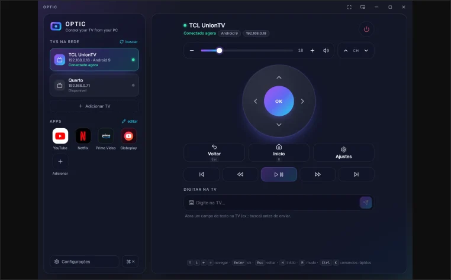
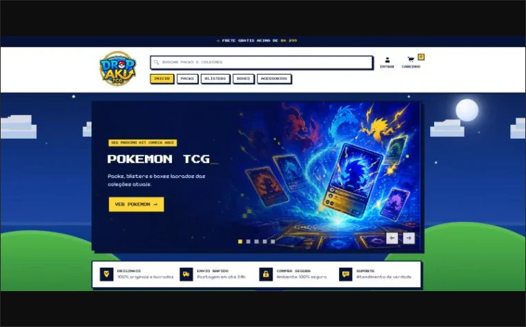

[Portfólio](https://andredeomondes.dev) · [Currículo PT-BR](https://andredeomondes.dev/resume/andre-deomondes-curriculo-pt-br.pdf) · [Resume EN](https://andredeomondes.dev/resume/andre-deomondes-resume-en.pdf) · [LinkedIn](https://linkedin.com/in/andredeomondes)

## Projetos selecionados

<table>
  <tr>
    <td width="50%" valign="top">
      
      <h3><a href="https://andredeomondes.dev/projects/optic">OPTIC</a></h3>
      
Controle remoto desktop de código aberto para TVs inteligentes pela rede local.

      
<code>Go</code> <code>Wails</code> <code>React</code>

      
<a href="https://github.com/andredeomondes/optic">Código</a> · Selecionado para o <a href="https://hub.xerj.org/corpus/andredeomondes--optic">XERJ Corpus Hub</a>

    </td>
    <td width="50%" valign="top">
      
      <h3><a href="https://andredeomondes.dev/projects/amr-mobile">AMR Mobile</a></h3>
      
Plataforma B2B freelance para consultar estoque e montar pedidos de iPhones no atacado.

      
<code>Angular</code> <code>NestJS</code> <code>Python</code>

    </td>
  </tr>
  <tr>
    <td width="50%" valign="top">
      
      <h3><a href="https://andredeomondes.dev/projects/drop-aki-tcg">Drop Aki TCG</a></h3>
      
E-commerce de cards colecionáveis, do catálogo ao checkout e à operação da loja.

      
<code>Astro</code> <code>React</code> <code>TypeScript</code>

    </td>
    <td width="50%" valign="top">
      
      <h3><a href="https://andredeomondes.dev/projects/caji-agent">CajiAgent</a></h3>
      
SaaS de atendimento com IA. Integrei WhatsApp, Instagram e a consulta de estoque pelo agente.

      
<code>React</code> <code>Fastify</code> <code>FastAPI</code>

    </td>
  </tr>
</table>

## Stack

- **Linguagens** ·  TypeScript ·  Java ·  Python
- **Frontend** ·  React ·  Angular ·  Astro
- **Backend** ·  NestJS ·  Spring Boot ·  FastAPI
- **Dados e infraestrutura** ·  PostgreSQL ·  Redis ·  Docker
- **Engenharia de IA** · Classificação de texto, avaliação de modelos e integração de agentes

[Série JavaScript Core](https://andredeomondes.dev/series/javascript-core) · [Publicações](https://andredeomondes.dev/posts)
