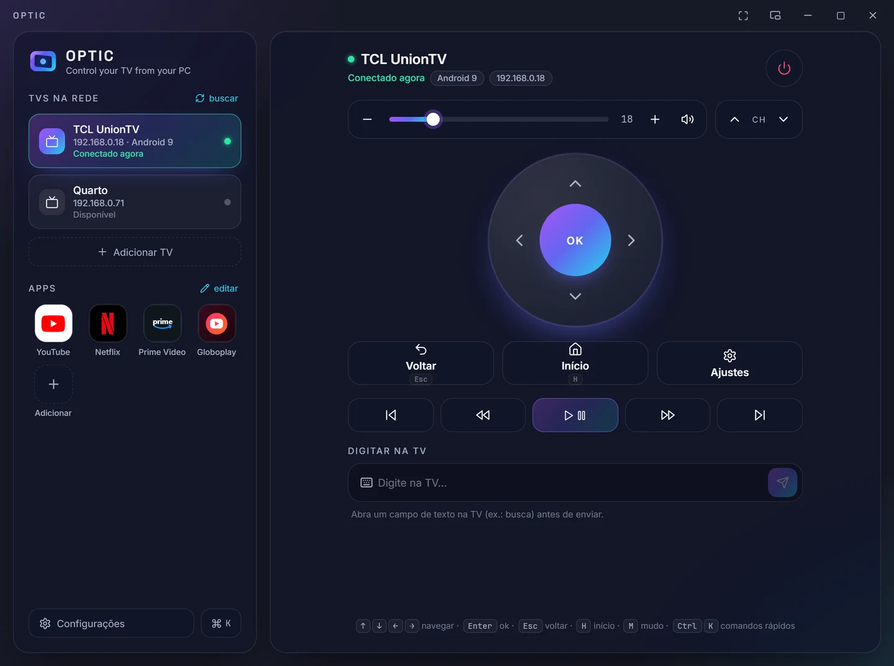

# André Deomondes

**Fullstack & IA Engineer** · Salvador, Bahia

Desenvolvo produtos full stack e sistemas de IA, da interface e APIs ao deploy.

[Portfólio](https://andredeomondes.dev) · [Currículo PT-BR](https://andredeomondes.dev/resume/andre-deomondes-curriculo-pt-br.pdf) · [Resume EN](https://andredeomondes.dev/resume/andre-deomondes-resume-en.pdf) · [LinkedIn](https://linkedin.com/in/andredeomondes)

## Projetos selecionados

### [OPTIC](https://github.com/andredeomondes/optic)

Controle remoto desktop de código aberto para TVs inteligentes pela rede local, feito com Go, Wails e React. Selecionado para o [XERJ Corpus Hub](https://hub.xerj.org/corpus/andredeomondes--optic).

### [AMR Mobile](https://andredeomondes.dev/projects/amr-mobile)

Plataforma B2B freelance para consulta de estoque e venda de iPhones no atacado. Desenvolvi a interface em Angular, a API em NestJS e as automações em Python.

[Drop Aki TCG](https://andredeomondes.dev/projects/drop-aki-tcg) · [CajiAgent](https://andredeomondes.dev/projects/caji-agent) · [Série JavaScript Core](https://andredeomondes.dev/series/javascript-core)

## Stack

- **Linguagens** · TypeScript, Java, Python
- **Frontend e backend** · React, Angular, NestJS, Spring Boot, FastAPI
- **Engenharia de IA** · Classificação de texto, avaliação de modelos e integração de agentes
**Dados e infraestrutura** · PostgreSQL, Redis, AWS, Docker, CI/CD
