  

  <a href="https://andredeomondes.dev"><b>portfólio</b></a>&nbsp;&nbsp;/&nbsp;&nbsp;
  <a href="https://andredeomondes.dev/projects">projetos</a>&nbsp;&nbsp;/&nbsp;&nbsp;
  <a href="https://andredeomondes.dev/series/javascript-core">javascript core</a>&nbsp;&nbsp;/&nbsp;&nbsp;
  <a href="https://andredeomondes.dev/posts">publicações</a>&nbsp;&nbsp;/&nbsp;&nbsp;
  <a href="https://andredeomondes.dev/resume">currículo</a>&nbsp;&nbsp;/&nbsp;&nbsp;
  <a href="https://linkedin.com/in/andredeomondes">linkedin</a>

 

Projeto backends, produtos digitais e sistemas com IA aplicada. Meu trabalho conecta regras de negócio, arquitetura e experiência para transformar problemas reais em software confiável, observável e preparado para evoluir.

Atuo entre **backend, produto e operação**: desenho APIs, integro serviços, organizo dados, automatizo fluxos, coloco aplicações em produção e documento as decisões que sustentam o sistema.

## `>_` Trabalho selecionado

<table>
  <tr>
    <td width="33%" valign="top">
      <h3><a href="https://andredeomondes.dev/projects/drop-aki-tcg">Drop Aki TCG</a></h3>
      E-commerce / TCG
      
E-commerce de cards colecionáveis construído de ponta a ponta, da experiência de compra à operação administrativa. Freelance e consultoria, com manutenção contínua em produção.

      <code>Astro 5</code> <code>React</code> <code>Node.js</code> <code>FastAPI</code> <code>PostgreSQL</code> <code>Redis</code>
    </td>
    <td width="33%" valign="top">
      <h3><a href="https://andredeomondes.dev/projects/amr-mobile">AMR Mobile</a></h3>
      Plataforma B2B / Atacado
      
Estoque e comercialização de iPhones no atacado. Desenvolvo o produto sozinho: aplicação web, API, contas, painel administrativo, web scraping e serviços de IA.

      <code>Angular</code> <code>NestJS</code> <code>Python</code> <code>LangChain</code> <code>PostgreSQL</code> <code>Playwright</code>
    </td>
    <td width="33%" valign="top">
      <h3><a href="https://andredeomondes.dev/projects/caji-agent">CajiAgent</a></h3>
      SaaS / Atendimento com IA
      
SaaS de atendimento, vendas e automação com IA, em uma equipe de quatro pessoas. Integrações com WhatsApp e Instagram e a ponte entre IA, áudio e estoque.

      <code>React</code> <code>Fastify</code> <code>FastAPI</code> <code>Gemini</code> <code>Whisper</code> <code>AWS</code>
    </td>
  </tr>
</table>

> Estudos de caso com telas reais, mapa de arquitetura, contribuição individual e decisões técnicas estão no [portfólio](https://andredeomondes.dev/projects).

## `>_` Engenharia em público

**[JavaScript Core](https://andredeomondes.dev/series/javascript-core)** é uma série completa com 27 unidades sobre os fundamentos que tornam JavaScript previsível em um backend: tipos, funções, closures, objetos, erros, módulos, Promises, event loop, JSON, imutabilidade, legibilidade e Big O.

Cada unidade tem resumo visual, leitura, código comentado e uma prática guiada com exercícios, testes, dicas graduais e resoluções. No site dá para buscar dentro de todo o conteúdo e filtrar por série, módulo e tags.

## `>_` Stack do dia a dia

  
  
  
  
  
  
  
  
  
  
  
  
  
  
  

| Camada | Ferramentas |
| --- | --- |
| Backend | Node.js, NestJS, Fastify, Python, FastAPI, Java, Spring Boot |
| IA aplicada | LangChain, Gemini, Groq, Whisper, agentes de IA |
| Dados | PostgreSQL, Redis, MongoDB |
| Frontend | React, Angular, Astro, Next.js, Vite, TypeScript |
| Cloud e qualidade | AWS, Docker, CI/CD, Playwright, testes unitários, de integração e E2E |

## `>_` Agora

- Backend Software Engineer na **AEX**.
- Desenvolvimento e manutenção contínua de **Drop Aki TCG** e **AMR Mobile**.
- Engenharia da Computação na **Universidade CIMATEC** e Técnico em Desenvolvimento de Sistemas no **SENAI Bahia**.

## `>_` Currículo

**[Português (PDF)](./resume/andre-deomondes-curriculo-pt-br.pdf)** &nbsp;/&nbsp; **[English (PDF)](./resume/andre-deomondes-resume-en.pdf)**

Uma página, uma coluna, texto selecionável e títulos de seção padrão, pensado para passar bem por sistemas de triagem (ATS) e ser rápido de ler. Também disponível em [andredeomondes.dev/resume](https://andredeomondes.dev/resume).

## `>_` Vamos conversar

Para construir ou evoluir um produto digital, abra o [andredeomondes.dev](https://andredeomondes.dev) e use **Falar comigo**: WhatsApp, e-mail ou LinkedIn em um clique. Ou escreva direto para [andredeomondes.dev@gmail.com](mailto:andredeomondes.dev@gmail.com).

  Salvador, Bahia &nbsp;/&nbsp; <a href="https://andredeomondes.dev">andredeomondes.dev</a>

