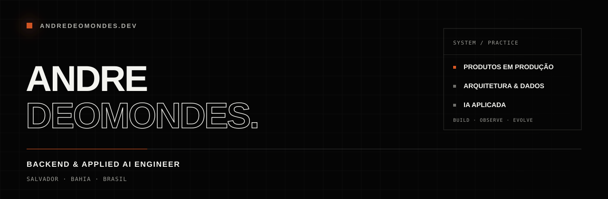

  

  <a href="https://andredeomondes.dev">portfólio</a>&nbsp;&nbsp;·&nbsp;&nbsp;
  <a href="https://andredeomondes.dev/projects">projetos</a>&nbsp;&nbsp;·&nbsp;&nbsp;
  <a href="https://andredeomondes.dev/posts">publicações</a>&nbsp;&nbsp;·&nbsp;&nbsp;
  <a href="https://linkedin.com/in/andredeomondes">linkedin</a>

Projeto backends, produtos digitais e sistemas com IA aplicada. Meu trabalho conecta regras de negócio, arquitetura e experiência para transformar problemas reais em software confiável, observável e preparado para evoluir.

Atuo entre **backend, produto e operação**: desenho APIs, integro serviços, organizo dados, automatizo fluxos, coloco aplicações em produção e documento as decisões que sustentam o sistema.

## Trabalho selecionado

### [Drop Aki TCG](https://dropakitcg.com.br) ↗

E-commerce de cards colecionáveis construído de ponta a ponta. Sou responsável pelo produto como desenvolvedor full stack em um trabalho de freelance e consultoria, da experiência de compra à operação administrativa e manutenção em produção.

`Astro 5` `React` `TypeScript` `Node.js` `FastAPI` `PostgreSQL` `Redis` `Wix Headless`

### [AMR Mobile](https://amrmobile.com.br) ↗

Plataforma B2B para estoque e comercialização de iPhones no atacado. Desenvolvo o produto sozinho, incluindo aplicação web, API, contas de usuários, painel administrativo, automações de dados, web scraping e serviços de IA.

`Angular` `NestJS` `Python` `FastAPI` `LangChain` `PostgreSQL` `Redis` `Playwright`

### [CajiAgent](https://cajiagent.com) ↗

SaaS de atendimento, vendas e automação com IA, desenvolvido por uma equipe de quatro pessoas. Durante um ano, atuei como desenvolvedor full stack nas integrações com WhatsApp e Instagram e na conexão entre IA, áudio e estoque.

`React` `Fastify` `FastAPI` `LangChain` `Gemini` `Groq` `Whisper` `AWS`

> Estudos de caso completos, com telas, arquitetura, contribuição individual e decisões técnicas, estão no [portfólio](https://andredeomondes.dev/projects).

## Engenharia em público

### [JavaScript Core](https://andredeomondes.dev/posts) — 18 de 27 unidades publicadas

Uma trilha prática sobre os fundamentos que tornam JavaScript previsível: conteúdo visual, exemplos, exercícios, entradas e saídas esperadas, testes e resoluções no próprio site.

Também escrevo sobre backend, arquitetura, qualidade, deploy e IA aplicada — sempre conectando o conceito ao que acontece em produtos reais.

## Ferramentas que fazem parte do trabalho

| Camada | Tecnologias |
| --- | --- |
| Backend | Node.js · NestJS · Fastify · Python · FastAPI · Java · Spring Boot |
| IA aplicada | LangChain · Gemini · Groq · Whisper |
| Dados | PostgreSQL · Redis · MongoDB |
| Frontend | React · Angular · Astro · Next.js · Vite · TypeScript |
| Cloud e qualidade | AWS · Docker · CI/CD · Playwright · testes unitários, de integração e E2E |

## Agora

- Backend Software Engineer na **AEX**.
- Engenharia da Computação na **Universidade CIMATEC**.
- Desenvolvimento e manutenção contínua de **Drop Aki TCG** e **AMR Mobile**.
- Publicação da série **JavaScript Core**.

## Vamos conversar

Se você quer construir ou evoluir um produto digital, pode começar pelo [briefing do site](https://andredeomondes.dev/#contato) ou falar comigo no [LinkedIn](https://linkedin.com/in/andredeomondes).

  Salvador, Bahia · <a href="mailto:andredeomondes.dev@gmail.com">andredeomondes.dev@gmail.com</a>

